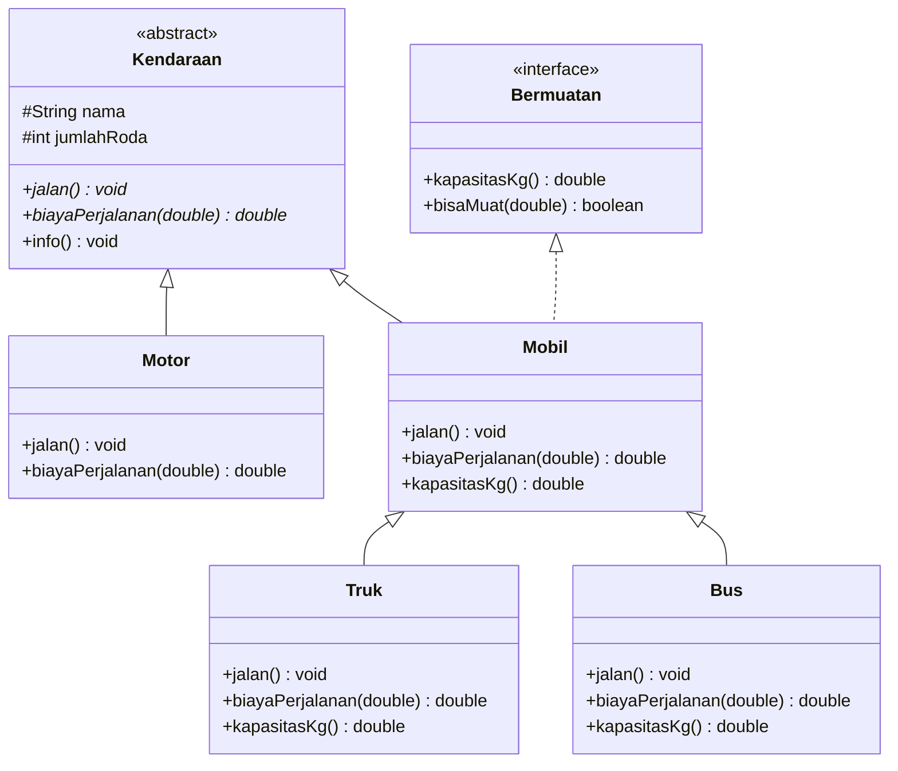

<div align="center">

# 🌇 OOP-KENDARAAN

**Simulasi kendaraan berbasis OOP: satu perintah, banyak perilaku.**


*Tugas diskusi: Abstract Class, Inheritance, Polymorphism, Interface, dan GUI*

</div>

---

## 📑 Daftar Isi

- [Tentang Proyek](#-tentang-proyek)
- [Anggota Kelompok](#-anggota-kelompok)
- [Class Diagram](#-class-diagram)
- [Konsep OOP yang Diterapkan](#-konsep-oop-yang-diterapkan)
- [Struktur Proyek](#-struktur-proyek)
- [Penjelasan Kode](#-penjelasan-kode)
- [Cara Menjalankan](#-cara-menjalankan)
- [Contoh Output](#-contoh-output)
- [Alur Kerja Polymorphism](#-alur-kerja-polymorphism)
- [Pembagian Tugas](#-pembagian-tugas)
- [Pengembangan Selanjutnya](#-pengembangan-selanjutnya)

---

## 🌆 Tentang Proyek

**OOP-KENDARAAN** adalah program Java yang mensimulasikan beberapa jenis kendaraan, yaitu **Motor**, **Mobil**, **Truk**, dan **Bus**. Setiap kendaraan bisa:

- 🚦 **berjalan** dengan gaya masing-masing,
- 💸 **menghitung biaya bensin** untuk jarak tertentu dengan tarif yang berbeda, dan
- 📦 **mengecek muatan** (khusus kendaraan yang meng-implement interface `Bermuatan`).

Proyek ini memperlihatkan bagaimana konsep inti OOP bekerja sama dalam satu program: **Abstract Class**, **Inheritance (pewarisan)**, **Polymorphism**, dan **Interface**. Program bisa dijalankan lewat **konsol** (`MainKendaraan`) maupun lewat **GUI** (`KendaraanGUI`).

> 💡 **Ide utamanya:** kita cukup memanggil `k.jalan()` dan `k.biayaPerjalanan()` pada satu daftar bertipe `Kendaraan`, dan Java otomatis menjalankan versi yang sesuai dengan jenis kendaraan aslinya.

---

## 👥 Anggota Kelompok

| Nama | NIM | Peran |
|---|---|---|
| Abrisam Satria Nuryono | F1D02510031 | Abstract class `Kendaraan`, README, setup repository |
| Miftahurrahman | F1D02510074 | Subclass `Motor`, `Mobil`, `Truk`, `Main`, class diagram |

**Kelas:** 3D

---

## 🗺️ Class Diagram



**Cara membaca diagram:**

| Simbol | Arti |
|---|---|
| `<<abstract>>` | Class abstrak, tidak bisa dibuat objeknya langsung |
| `<<interface>>` | Interface, berisi kontrak yang harus dipenuhi class yang meng-implement |
| `*` setelah nama method | Method abstrak (tanpa isi) |
| `#` | Atribut `protected` (bisa diakses subclass) |
| `+` | Method `public` |
| Panah segitiga garis penuh | Pewarisan (`extends`), dari anak menuju induk |
| Panah segitiga garis putus-putus | Implementasi interface (`implements`) |

---

## 🧠 Konsep OOP yang Diterapkan

| Konsep | Di mana | Penjelasan |
|---|---|---|
| 🧩 **Abstract Class** | `Kendaraan` | Kerangka umum semua kendaraan. Tidak bisa dibuat objeknya (`new Kendaraan()` akan error) karena "kendaraan" saja terlalu umum. |
| ✏️ **Abstract Method** | `jalan()` dan `biayaPerjalanan()` | Hanya berisi deklarasi tanpa isi. Setiap subclass **wajib** menuliskan isinya sendiri. |
| 🧬 **Inheritance** | `Motor`, `Mobil` extends `Kendaraan`; `Truk`, `Bus` extends `Mobil` | Subclass otomatis mewarisi atribut `nama`, `jumlahRoda`, dan method `info()`. Pewarisan `Truk` dan `Bus` bersifat **bertingkat** (multilevel). |
| 🔁 **Overriding** | Semua subclass | Subclass menulis ulang method dari induk dengan versinya sendiri, ditandai `@Override`. |
| ⬆️ **`super`** | Constructor semua subclass, `Truk`, dan `Bus` | `super(...)` memanggil constructor induk. `super.jalan()` dan `super.biayaPerjalanan()` memanggil versi milik `Mobil` lalu menambahkan perilaku baru. |
| 🔌 **Interface** | `Bermuatan` (di-implement `Mobil`, diwariskan ke `Truk` dan `Bus`) | Kontrak `kapasitasKg()` yang wajib diisi, plus *default method* `bisaMuat()` yang sudah punya isi. |
| 🎭 **Polymorphism** | `MainKendaraan.java` dan `KendaraanGUI.java` | Variabel bertipe `Kendaraan` berisi `Motor`, `Mobil`, `Truk`, atau `Bus`. Saat method dipanggil, Java memilih versi sesuai objek aslinya (*dynamic binding*). |
| 🖼️ **GUI (Swing)** | `KendaraanGUI` | Antarmuka grafis untuk memilih kendaraan, mengisi jarak dan muatan, lalu melihat hasilnya. |

---

## 📂 Struktur Proyek

```
OOP-KENDARAAN/
├── 📄 README.md
├── 🖼️ class-diagram.png
├── ☕ Kendaraan.java        # abstract class (induk)
├── ☕ JenisKendaraan.java   # Motor, Mobil, Truk, Bus (subclass)
├── ☕ Bermuatan.java        # interface untuk kendaraan pengangkut muatan
├── ☕ MainKendaraan.java    # program konsol (demo polymorphism)
└── ☕ KendaraanGUI.java     # program GUI (Swing)
```

---

## 🔍 Penjelasan Kode

### 1️⃣ `Kendaraan.java`: Abstract Class

Induk dari semua kendaraan. Berisi data umum dan dua method abstrak.

```java
public abstract class Kendaraan {
    protected String nama;
    protected int jumlahRoda;

    public abstract void jalan();                           // wajib di-override
    public abstract double biayaPerjalanan(double jarakKm); // wajib di-override

    public void info() { ... }                              // diwariskan apa adanya
}
```

### 2️⃣ `Bermuatan.java`: Interface

Kontrak untuk kendaraan yang bisa mengangkut muatan.

```java
public interface Bermuatan {
    double kapasitasKg();                       // wajib diisi class yang implement

    default boolean bisaMuat(double beratKg) {  // default method: sudah ada isinya
        return beratKg <= kapasitasKg();
    }
}
```

### 3️⃣ `JenisKendaraan.java`: Inheritance dan Overriding

| Class | Induk | Roda | Tarif per km | Kapasitas muatan | Perilaku `jalan()` |
|---|---|---|---|---|---|
| 🏍️ `Motor` | `Kendaraan` | 2 | Rp 400 | tidak ada | Melaju lincah menembus kemacetan |
| 🚗 `Mobil` | `Kendaraan` | 4 | Rp 1.200 | 500 kg | Melaju nyaman dengan AC menyala |
| 🚛 `Truk` | `Mobil` | 6 | 2 × tarif Mobil = Rp 2.400 | 5.000 kg | Memanggil `super.jalan()`, lalu menambah "sambil mengangkut muatan berat" |
| 🚌 `Bus` | `Mobil` | 6 | 1,5 × tarif Mobil = Rp 1.800 | 1.000 kg | Melaju membawa banyak penumpang |

### 4️⃣ `MainKendaraan.java`: Demo Polymorphism (konsol)

Membuat array bertipe `Kendaraan[]` yang berisi `Motor`, `Mobil`, dan `Truk`, lalu memanggil `info()`, `jalan()`, dan `biayaPerjalanan()` lewat satu perulangan.

### 5️⃣ `KendaraanGUI.java`: Tampilan Grafis

Jendela Swing dengan:

- pilihan jenis kendaraan (Motor, Mobil, Truk, Bus),
- isian nama, jarak (km), dan muatan (kg),
- tombol **Jalankan** yang menampilkan info, perilaku `jalan()`, biaya perjalanan, dan status muatan (AMAN atau MELEBIHI KAPASITAS).

Kolom muatan hanya aktif untuk kendaraan yang meng-implement `Bermuatan` (dicek dengan `instanceof`). Class `Kendaraan` dan turunannya tidak diubah untuk keperluan GUI.

---

## ▶️ Cara Menjalankan

**Prasyarat:** JDK 17 atau lebih baru.

Taruh semua file `.java` dalam satu folder, lalu kompilasi:

```bash
javac *.java
```

**Versi konsol:**

```bash
java MainKendaraan
```

**Versi GUI:**

```bash
java KendaraanGUI
```

Di VS Code, bisa juga membuka file `MainKendaraan.java` atau `KendaraanGUI.java` lalu menekan tombol **Run** di atas method `main`.

---

## 🖥️ Contoh Output

**Konsol (`MainKendaraan`), jarak 50 km:**

```
Kendaraan : Honda Beat (2 roda)
Honda Beat melaju lincah menembus kemacetan.
Biaya 50 km : Rp 20.000
-------------------
Kendaraan : Toyota Avanza (4 roda)
Toyota Avanza melaju nyaman dengan AC menyala.
Biaya 50 km : Rp 60.000
-------------------
Kendaraan : Hino Dutro (6 roda)
Hino Dutro melaju nyaman dengan AC menyala.
   ...sambil mengangkut muatan berat.
Biaya 50 km : Rp 120.000
-------------------
```

**GUI (`KendaraanGUI`), Truk "Hino Dutro", jarak 50 km, muatan 6000 kg:**

```
Kendaraan : Hino Dutro (6 roda)
Hino Dutro melaju nyaman dengan AC menyala.
   ...sambil mengangkut muatan berat.
Biaya 50 km : Rp 120.000
Kapasitas   : 5000 kg
Muatan 6000 kg : MELEBIHI KAPASITAS!
-------------------
```

---

## 🔄 Alur Kerja Polymorphism

```
Kendaraan k = new Truk("Hino Dutro");
k.jalan();
```

1. Variabel `k` bertipe **`Kendaraan`**, tetapi objek aslinya adalah **`Truk`**.
2. Saat `k.jalan()` dipanggil, Java melihat **objek aslinya** (bukan tipe variabelnya).
3. Java menjalankan `jalan()` milik `Truk`, yang lebih dulu memanggil `super.jalan()` milik `Mobil`.
4. Inilah **dynamic binding**: satu perintah yang sama menghasilkan perilaku berbeda untuk tiap jenis kendaraan.

Hal yang sama berlaku untuk interface: `Bermuatan b = (Bermuatan) k;` lalu `b.kapasitasKg()` menghasilkan nilai sesuai objek aslinya (500 untuk `Mobil`, 5000 untuk `Truk`, 1000 untuk `Bus`).

---

## 📝 Pembagian Tugas

| Bagian | Penanggung jawab |
|---|---|
| Abstract class `Kendaraan`, README, setup repository | Abrisam Satria Nuryono |
| Subclass `Motor`, `Mobil`, `Truk`, `Main`, class diagram | Miftahurrahman |
| Interface `Bermuatan`, subclass `Bus`, GUI `KendaraanGUI` | Bersama |

---

## 🚀 Pengembangan Selanjutnya

- 🧪 Menambah jenis kendaraan lain (misalnya sepeda listrik) dengan tarif sendiri.
- 🧾 Menyimpan riwayat perjalanan di GUI ke file.
- 🔌 Menambah interface lain, misalnya `BisaDiservis`.
- 🧰 Menambah unit test untuk perhitungan biaya dan kapasitas.
