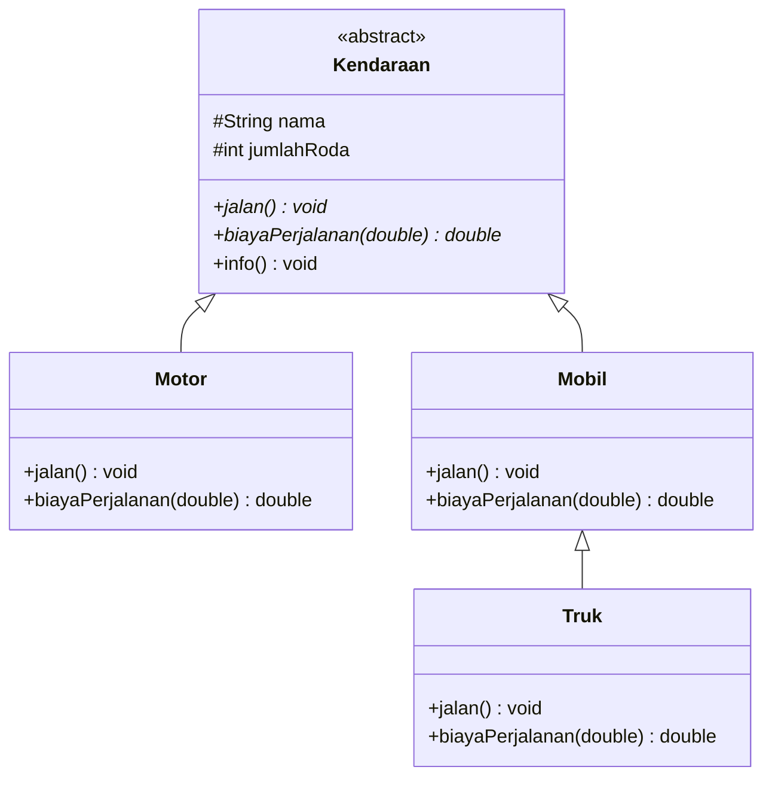

<div align="center">

# 🌇 Roda Senja

**Simulasi kendaraan berbasis OOP: satu perintah, banyak perilaku.**


*Tugas diskusi: Abstract Class, Inheritance, dan Polymorphism*

</div>

---

## 📑 Daftar Isi

- [Tentang Proyek](#-tentang-proyek)
- [Anggota Kelompok](#-anggota-kelompok)
- [Class Diagram](#-class-diagram)
- [Konsep OOP yang Diterapkan](#-konsep-oop-yang-diterapkan)
- [Struktur Proyek](#-struktur-proyek)
- [Penjelasan Kode](#-penjelasan-kode)
- [Cara Menjalankan](#-cara-menjalankan)
- [Contoh Output](#-contoh-output)
- [Alur Kerja Polymorphism](#-alur-kerja-polymorphism)
- [Pembagian Tugas](#-pembagian-tugas)
- [Pengembangan Selanjutnya](#-pengembangan-selanjutnya)

---

## 🌆 Tentang Proyek

**Roda Senja** adalah program Java sederhana yang mensimulasikan beberapa jenis kendaraan, yaitu **Motor**, **Mobil**, dan **Truk**. Setiap kendaraan bisa:

- 🚦 **berjalan** dengan gaya masing-masing, dan
- 💸 **menghitung biaya bensin** untuk jarak tertentu dengan tarif yang berbeda.

Proyek ini dibuat untuk memperlihatkan bagaimana tiga konsep inti OOP bekerja sama dalam satu program kecil: **Abstract Class**, **Inheritance (pewarisan)**, dan **Polymorphism**.

> 💡 **Ide utamanya:** kita cukup memanggil `k.jalan()` dan `k.biayaPerjalanan()` pada satu daftar bertipe `Kendaraan`, dan Java otomatis menjalankan versi yang sesuai dengan jenis kendaraan aslinya.

---

## 👥 Anggota Kelompok

| Nama | NIM | Peran |
|------|-----|-------|
| Abrisam Satria Nuryono | F1D02510031 | Abstract class `Kendaraan`, README, setup repository |
| Miftahurrahman | F1D02510074 | Subclass `Motor`, `Mobil`, `Truk`, `Main`, class diagram |

**Kelas:** 3D

---

## 🗺️ Class Diagram



**Cara membaca diagram:**

| Simbol | Arti |
|--------|------|
| `<<abstract>>` | Class abstrak, tidak bisa dibuat objeknya langsung |
| `*` setelah nama method | Method abstrak (tanpa isi) |
| `#` | Atribut `protected` (bisa diakses subclass) |
| `+` | Method `public` |
| Panah segitiga kosong | Pewarisan (`extends`), dari anak menuju induk |

---

## 🧠 Konsep OOP yang Diterapkan

| Konsep | Di mana | Penjelasan |
|--------|---------|------------|
| 🧩 **Abstract Class** | `Kendaraan` | Kerangka umum semua kendaraan. Tidak bisa dibuat objeknya (`new Kendaraan()` akan error) karena "kendaraan" saja terlalu umum. |
| ✏️ **Abstract Method** | `jalan()` dan `biayaPerjalanan()` | Hanya berisi deklarasi tanpa isi. Setiap subclass **wajib** menuliskan isinya sendiri. |
| 🧬 **Inheritance** | `Motor`, `Mobil` extends `Kendaraan`; `Truk` extends `Mobil` | Subclass otomatis mewarisi atribut `nama`, `jumlahRoda`, dan method `info()` tanpa menulis ulang. Pewarisan `Truk` bersifat **bertingkat** (multilevel). |
| 🔁 **Overriding** | Semua subclass | Subclass menulis ulang method dari induk dengan versinya sendiri, ditandai `@Override`. |
| ⬆️ **`super`** | Constructor semua subclass dan `Truk` | `super(...)` memanggil constructor induk. `super.jalan()` dan `super.biayaPerjalanan()` di `Truk` memanggil versi milik `Mobil` lalu menambahkan perilaku baru. |
| 🎭 **Polymorphism** | `Main.java` | Array bertipe `Kendaraan[]` berisi `Motor`, `Mobil`, dan `Truk`. Saat method dipanggil, Java memilih versi sesuai objek aslinya (*dynamic binding*). |

---

## 📂 Struktur Proyek

```
roda-senja/
├── 📄 README.md
└── 📁 src/
    ├── ☕ Kendaraan.java        # abstract class (induk)
    ├── ☕ JenisKendaraan.java   # Motor, Mobil, Truk (subclass)
    └── ☕ Main.java             # program utama (demo polymorphism)
```

---

## 🔍 Penjelasan Kode

### 1️⃣ `Kendaraan.java`: Abstract Class

Induk dari semua kendaraan. Berisi data umum dan dua method abstrak.

```java
public abstract class Kendaraan {
    protected String nama;
    protected int jumlahRoda;

    public abstract void jalan();                          // wajib di-override
    public abstract double biayaPerjalanan(double jarakKm); // wajib di-override

    public void info() { ... }                             // diwariskan apa adanya
}
```

### 2️⃣ `JenisKendaraan.java`: Inheritance dan Overriding

| Class | Induk | Roda | Tarif per km | Perilaku `jalan()` |
|-------|-------|:----:|--------------|--------------------|
| 🏍️ `Motor` | `Kendaraan` | 2 | Rp 400 | Melaju lincah menembus kemacetan |
| 🚗 `Mobil` | `Kendaraan` | 4 | Rp 1.200 | Melaju nyaman dengan AC menyala |
| 🚛 `Truk` | `Mobil` | 6 | 2 × tarif Mobil = Rp 2.400 | Memanggil
